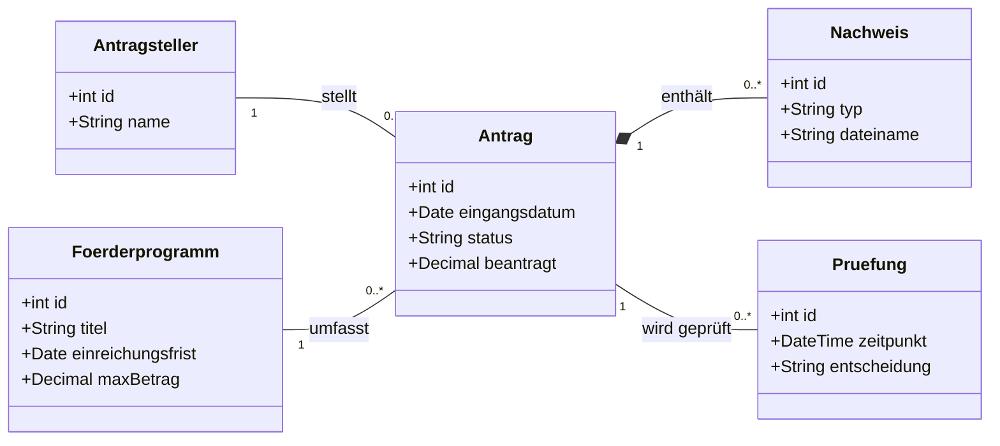

# Prüfungssimulation sim05 – Planen eines Softwareproduktes (Musterlösungen)

**Bearbeitungszeit:** 90 Minuten
**Erreichbare Punkte:** 100
**Aufgaben:** 4 Hauptaufgaben.


## Ausgangssituation

Die fiktive **KommunaSoft GmbH** entwickelt für mehrere Gemeinden das Portal **GrünAntrag**. Bürgerinnen, Bürger und örtliche Vereine können darin Zuschüsse für Dachbegrünungen beantragen. Sachbearbeitende prüfen die Anträge; eine bewilligte Auszahlung wird später von der kommunalen Kasse erfasst. Die bisherige Bearbeitung erfolgt per Post und Tabellenkalkulation.

Ein Förderprogramm besitzt eine Kennung, einen Titel, eine Einreichungsfrist und einen Höchstbetrag pro Antrag. Antragstellende besitzen eine eindeutige Kennung. Ein Antrag gehört genau einem Antragstellenden und genau einem Programm. Zu einem Antrag können beliebig viele PDF-Nachweise erfasst werden. Jeder Nachweis ist ausschließlich Bestandteil seines Antrags und besitzt keinen eigenständigen fachlichen Lebenszyklus. Jede fachliche Prüfung wird als eigenständig identifizierbarer Protokolldatensatz mit Zeitpunkt und Entscheidung erfasst und gehört genau einem Antrag. Ein Antrag kann mehrfach geprüft werden; frühere Prüfungsdatensätze bleiben auch nach einer erneuten Prüfung bestehen. Prüfungsdatensätze werden unabhängig von den Nachweisdateien verwaltet. Eine Lösch- oder Aufbewahrungsregel für Prüfungsdatensätze bei Löschung eines Antrags ist nicht Gegenstand dieser Aufgabe.

Für die aktuelle Pilotversion gelten ausdrücklich folgende **betriebliche Regeln**. Die Einreichungsfrist und der Höchstbetrag sind für alle Förderprogramme der Pilotversion einheitlich; die jeweiligen Programmattribute enthalten diese Werte:

- Anträge können bis einschließlich **30.11.2026** eingereicht werden.
- Ein Antrag ist vollständig, wenn das unterschriebene Antragsformular und ein Kostenvoranschlag als PDF vorhanden sind. Je Datei höchstens **10 MiB**.
- Pro Antragstellerkennung darf im **gleichen Programm und Kalenderjahr** nur ein Antrag erfolgreich eingereicht werden. Bereits eingereichte Anträge zählen unabhängig vom späteren Bearbeitungsstatus; gespeicherte Entwürfe und bei der Vorprüfung zurückgewiesene Einreichungsversuche zählen nicht. Ein Antrag in einem anderen Programm ist zulässig.
- Der beantragte Betrag muss größer als 0 Euro und höchstens **5.000 Euro** sein.
- Für die fachliche Vorprüfung werden die folgenden Prüfergebnisse benötigt: **ANNEHMEN**, **FRIST**, **UNVOLLSTAENDIG**, **DOPPELT**, **BETRAG**.
- Bei mehreren Regelverletzungen hat diese Reihenfolge Vorrang: Frist, Doppelantrag, Unvollständigkeit, Betrag.
- Die öffentliche Erfassungsoberfläche darf Antragstellerdaten nur der angemeldeten Person selbst zugänglich machen. Sachbearbeitende dürfen zugewiesene Anträge lesen und prüfen, aber keine Auszahlungen freigeben.

## Aufgabe 1: Spezifikation und Änderungssteuerung (25 Punkte)

### 1a – 9 Punkte

Formulieren Sie drei eigenständige, eindeutig testbare funktionale Anforderungen für die Einreichung eines Antrags. Beziehen Sie sich dabei auf **Frist**, **Nachweisdokumente** und **Mehrfacheinreichung**. Formulieren Sie jeweils die erforderliche Reaktion der Anwendung. Berücksichtigen Sie bei mehreren Regelverletzungen die vorgegebene Prüfreihenfolge.

**Lösung**

1. Liegt das Eingangsdatum nach dem 30.11.2026, gibt die Anwendung **FRIST** zurück. Bis einschließlich 30.11.2026 ist die Fristprüfung erfolgreich; die weiteren Regeln werden geprüft. (Bedingung, Grenze, Reaktion: je 1 P.)
2. Nach erfolgreicher Fristprüfung gibt die Anwendung **DOPPELT** zurück, wenn zur selben Antragstellerkennung im gleichen Programm und Kalenderjahr bereits ein Antrag erfolgreich eingereicht wurde. Entwürfe und bei der Vorprüfung zurückgewiesene Einreichungsversuche zählen nicht. Andernfalls folgt die Vollständigkeitsprüfung. (Schlüssel/Kontext, Gleichjahr-Bedingung, Reaktion: je 1 P.)
3. Nach erfolgreicher Frist- und Doppelantragsprüfung prüft die Anwendung, ob das unterschriebene Antragsformular und der Kostenvoranschlag als gültige PDF-Dateien mit jeweils höchstens 10 MiB vorhanden sind. Fehlt ein Pflichtnachweis oder erfüllt er die Vorgaben nicht, gibt die Anwendung **UNVOLLSTAENDIG** zurück; andernfalls folgt die Betragsprüfung. (Vollständigkeit, Format/Größe, Reaktion: je 1 P.)

Die Regeln sind in der Reihenfolge Frist, Doppelantrag, Unvollständigkeit, Betrag auszuwerten. **ANNEHMEN** wird nur zurückgegeben, wenn alle Prüfungen erfolgreich sind.

Alternative testbare Formulierungen sind zulässig, wenn sie die festgelegten Geschäftsregeln ohne Widerspruch abbilden.

**Bewertung**

Jeweils 3 Punkte pro überprüfbarer Anforderung.

### 1b – 10 Punkte

Ermitteln Sie für jeden der folgenden Fälle das **eine** fachliche Prüfergebnis nach den beschriebenen Regeln. Alle Einreichungen erfolgen 2026. Die beantragten Beträge stehen in der Tabelle. "Doppelt" bedeutet: Ein Antrag derselben Antragstellerkennung im gleichen Programm und im gleichen Kalenderjahr wurde bereits erfolgreich eingereicht.

| Fall | Eingangsdatum | Vollständig | Doppelt | Beantragt | Prüfergebnis |
|---|---|---|---|---:|---|
| A | 30.11.2026 | ja | nein | 5.000 € | ? |
| B | 01.12.2026 | nein | ja | 7.000 € | ? |
| C | 21.11.2026 | nein | nein | 2.000 € | ? |
| D | 21.11.2026 | ja | ja | 2.000 € | ? |
| E | 21.11.2026 | ja | nein | 5.001 € | ? |

**Lösung**

| Fall | Prüfergebnis | Begründung |
|---|---|---|
| A | ANNEHMEN | Fristtag ist eingeschlossen; 5.000 € erlaubt |
| B | FRIST | Spätes Datum ist die erste verletzte Regel |
| C | UNVOLLSTAENDIG | Pflichtdokument fehlt |
| D | DOPPELT | Bereits eingereicht in demselben Programm/Jahr |
| E | BETRAG | 5.001 € überschreitet die Obergrenze |

Die angegebenen Codes und fachlich eindeutig gleichwertige ausgeschriebene Ergebnisbezeichnungen sind mit jeweils 2 P. zu bewerten. Ist die Antwort mehrdeutig, aber die maßgebliche Regelverletzung eindeutig erkennbar, wird 1 P. vergeben. Bei falscher Regelverletzung oder falscher Annahmeentscheidung werden 0 P. vergeben.

**Bewertung**

2 Punkte je Fall.

### 1c – 6 Punkte

Die Auftraggeberin beantragt nach der Abnahme der Spezifikation zusätzlich den Upload von Bilddateien. Beschreiben Sie **drei konkrete Schritte** eines kontrollierten Änderungsverfahrens und jeweils dessen Nutzen für das Projekt.

**Lösung**

Änderungsantrag dokumentieren und präzisieren (nachvollziehbarer Umfang); Auswirkungen auf Dateiprüfung, Sicherheitsrisiken, Aufwand und Tests bewerten (belastbare Entscheidung); Freigabe/Priorisierung durch zuständige Auftraggebende mit Anpassung von Backlog, Akzeptanzkriterien und Testfällen (gesteuerte Umsetzung). Gleichwertige kontrollierte Verfahren zulassen.

**Bewertung**

Drei Schritte mit Nutzen, je 2 P.

## Aufgabe 2: Werkzeuge, Architektur und Sicherheit (25 Punkte)

Die Anwendung soll mithilfe einer Java-Bibliothek PDF-Dateien auf zulässiges Dateiformat und Seitenzahl prüfen. Zwei technisch kompatible Kandidaten wurden anhand einer Skala von 1 (schlecht) bis 5 (sehr gut) bewertet. Beide können nach ihrer dokumentierten Lizenz für den vorgesehenen Einsatz eingesetzt werden.

| Kriterium | Gewicht | Bibliothek A | Bibliothek B |
|---|---:|---:|---:|
| Wartbarkeit | 40 % | 4 | 3 |
| Funktionsumfang | 30 % | 3 | 5 |
| Sicherheitspflege | 20 % | 4 | 2 |
| Einarbeitungsaufwand (5 = wenig Aufwand) | 10 % | 2 | 5 |

### 2a – 8 Punkte

Berechnen Sie für beide Alternativen den gewichteten Nutzwert (Skala 1 bis 5). Stellen Sie den Rechenweg dar, nennen Sie den rechnerischen Sieger und geben Sie die Differenz zwischen den beiden Nutzwerten an.

**Lösung**

A = 0,40×4 + 0,30×3 + 0,20×4 + 0,10×2 = **3,50**. B = 0,40×3 + 0,30×5 + 0,20×2 + 0,10×5 = **3,60**. **B** liegt rechnerisch um **0,10 Skalenpunkte** vorn. Je 3 P. vollständig korrekte Berechnung, 1 P. Sieger und 1 P. Differenz. Bei Rechenfolgefehlern Folgerichtigkeit berücksichtigen.

### 2b – 5 Punkte

Wählen Sie unter Berücksichtigung des kleinen Unterschieds der Nutzwerte eine der Bibliotheken aus und begründen Sie die Entscheidung mit **zwei konkreten Kriterien** aus der Tabelle und **einem fachlichen Risiko**.

**Lösung**

Beispiel: A kann trotz geringfügig niedrigerem Nutzwert bevorzugt werden, weil die Wartbarkeit (4 statt 3) und die Sicherheitspflege (4 statt 2) höher bewertet sind. Die niedrigere Bewertung der Sicherheitspflege bei B deutet auf das Risiko hin, dass Sicherheitslücken nicht ausreichend schnell behoben werden; tatsächlich verzögerte Updates sind damit nicht nachgewiesen. Alternativ ist B mit Funktionsumfang 5 und geringerem Einarbeitungsaufwand (Bewertung 5) begründbar; dabei ist das mögliche Risiko länger ungepatchter Sicherheitslücken zu berücksichtigen. 1 P. eindeutige Entscheidung, 2×1 P. situativer Kriterienbezug, 2 P. nachvollziehbare Risikofolge. **Keine Pflicht, den rechnerischen Sieger zu wählen.**

### 2c – 8 Punkte

Entwickeln Sie **vier konkrete technische Schutzmaßnahmen** für den Upload und die spätere Anzeige der Antragsdokumente. Geben Sie jeweils an, welches Risiko dadurch reduziert wird.

**Lösung**

- Serverseitige Prüfung der Dateisignatur, der tatsächlichen PDF-Struktur und des Größenlimits von 10 MiB; Dateiendung und vom Client gemeldeter MIME-Typ allein reichen nicht aus. Dies reduziert unerlaubte Uploads und übermäßigen Ressourcenverbrauch, garantiert aber keine Schadcodefreiheit.
- Schadsoftwareprüfung vor Freigabe und isolierte PDF-Verarbeitung mit Ressourcenlimits und deaktivierten aktiven Inhalten: reduziert das Risiko durch Malware und schädliche PDF-Inhalte. Auch ein negativer Scan garantiert keine Unbedenklichkeit.
- Objektbezogene serverseitige Autorisierungsprüfung bei jedem Dokumentabruf anhand der Zugehörigkeit zum angemeldeten Antragsteller bzw. der Zuweisung an Sachbearbeitende: reduziert unberechtigte Einsicht auch bei bekannter oder erratbarer URL.
- Speicherung außerhalb öffentlich erreichbarer Webverzeichnisse mit serverseitig erzeugten zufälligen IDs und protokolliertem Zugriff: reduziert direkte unkontrollierte Zugriffe und unterstützt die Nachvollziehbarkeit. Zufällige IDs ersetzen keine Autorisierung.

Weitere passende Paare: TLS, Rate Limiting, begrenzte Speicherquoten, sichere Dateinamen, PDF-Re-Rendering. Je Paar 1 P. für eine geeignete technische Maßnahme und 1 P. für die zutreffende Risikoreduktion. Gleichartige Maßnahmen nicht doppelt bewerten.

**Bewertung**

Vier Maßnahme/Risiko-Paare à 2 P.

### 2d – 4 Punkte

Erläutern Sie je **einen Unterschied** zwischen einer Bibliothek und einem Framework sowie zwischen einer lokalen Build-Prüfung und einer automatisierten Prüfung in einer CI-Pipeline.

**Lösung**

Bibliothek wird gezielt vom Anwendungscode aufgerufen, bei einem Framework folgt die Anwendung typischerweise dessen vorgegebenem Lebenszyklus/Steuerfluss (**Inversion of Control**) (2 P.). Ein lokaler Build prüft die individuelle Arbeitskopie in der lokalen Entwicklungsumgebung und kann dieselben Tests wie die CI-Pipeline ausführen. Die CI-Pipeline führt definierte Builds und Tests automatisiert in einer festgelegten Umgebung aus, beispielsweise bei einem Push oder Pull Request, und stellt die Ergebnisse dem Team bereit (2 P.).

## Aufgabe 3: Objektorientierte Fachmodellierung (25 Punkte)

Für eine Architekturentscheidung soll ein **UML-Klassendiagramm** auf Fachebene erstellt werden. Modellieren Sie diese Klassen mit den jeweils genannten Attributen:

- **Antragsteller:** id: int, name: String
- **Foerderprogramm:** id: int, titel: String, einreichungsfrist: Date, maxBetrag: Decimal
- **Antrag:** id: int, eingangsdatum: Date, status: String, beantragt: Decimal
- **Nachweis:** id: int, typ: String, dateiname: String
- **Pruefung:** id: int, zeitpunkt: DateTime, entscheidung: String

### 3a – 17 Punkte

Erstellen Sie das vollständige UML-Klassendiagramm mit den fünf Klassen, allen genannten Attributen, den fachlich zutreffenden **vier Beziehungen** und deren Multiplizitäten. Stellen Sie den Nachweis als Teil des Antrags mit **Komposition** dar; die anderen Beziehungen sind normale Assoziationen.

**Lösung**

Vollständiges Fachmodell:



Editierbare Fassung: [UMLet (UXF)](./sim05_planen_softwareprodukt_lösung_3a.uxf).

**Bewertung**

- Fünf fachlich zutreffende Klassen: je 1 P. (5 P.).
- 16 Attribute einschließlich fachlich passender Datentypen: 5 P. proportional nach Anzahl der korrekt zugeordneten und typisierten Attribute (Anzahl / 16 × 5). Je Attribut zählt ein korrekter Name bzw. eine sinngleiche Bezeichnung mit passendem Datentyp einmal. Erst die Attribut-Teilsumme auf den nächsten halben Punkt runden.
- Vier fachlich korrekte Verbindungen: je 1 P. (4 P.).
- Acht korrekte Multiplizitäten: je 0,25 P. (2 P.).
- Kompositionsdiamant am Antrag-Ende der Nachweis-Beziehung: 1 P.

Keine Punktabzüge für sinnvolle Anordnungs- oder Namensvarianten. Der Kompositionsdiamant wird separat bewertet.

### 3b – 8 Punkte

Erläutern Sie anhand Ihres Diagramms, weshalb für Nachweise eine **Komposition** festgelegt wurde, für Prüfungen dagegen eine **normale Assoziation**. Erläutern Sie zusätzlich anhand einer konkreten Beziehung Ihres Diagramms die Bedeutung der Multiplizitäten **1** und **0..*** an ihren beiden Enden.

**Lösung**

Ein Nachweis ist ausschließlich Bestandteil seines konkreten Antrags und besitzt keinen eigenständigen fachlichen Lebenszyklus. Die Komposition drückt diese Ganzes-Teil-Beziehung aus; bei Löschung des Antrags werden dessen zugehörige Nachweise im Fachmodell mitgelöscht (3 P.). Prüfungseinträge sind eigenständig identifizierbare Protokolldatensätze, die bei erneuten Prüfungen erhalten bleiben und unabhängig von den Nachweisdateien verwaltet werden. Eine normale Assoziation bildet die Zuordnung zum Antrag ab, ohne eine kompositionsbedingte Lebenszyklusabhängigkeit festzulegen. Sie garantiert jedoch keine Aufbewahrung nach Löschung des Antrags; dazu wären zusätzliche Regeln erforderlich (3 P.). Am Ende **Antragsteller 1** bedeutet die Multiplizität, dass jeder Antrag genau einem Antragsteller zugeordnet ist. Am Ende **Antrag 0..*** bedeutet sie, dass ein Antragsteller keinen, einen oder mehrere Anträge haben kann (je 1 P.). Fachlich gleichwertige Begründungen sind zulässig, sofern sie den vorgegebenen Geschäftsregeln und Beziehungstypen nicht widersprechen.

## Aufgabe 4: Bedienoberfläche und Qualitätskontrolle (25 Punkte)

Ein früher Entwurf des Antragsformulars sieht so aus:

```text
ANTRAG STELLEN
Antragsteller-ID: [ 174 ]
Programm:        [ Dachbegrünung v ]
Beantragter Betrag: [ 5000 ]
Datei:           [ Datei wählen ]  (unbegrenzte Anzahl/Größe)
[ABSENDEN]
Bei fehlerhafter Eingabe: "Fehler 12".
Nach dem Absenden erscheint unabhängig vom Ergebnis: "Gespeichert".
```

### 4a – 9 Punkte

Analysieren Sie **drei konkrete Probleme** hinsichtlich Benutzbarkeit, Rückmeldung oder Sicherheit/Barrierefreiheit. Beschreiben Sie jeweils eine geeignete Verbesserung und ihren Nutzen.

**Lösung**

- **Editierbare Antragsteller-ID:** Das Feld ermöglicht fehlerhafte oder manipulierte Zuordnungsversuche. Falls der Server die übermittelte ID ungeprüft übernimmt, können Anträge einer fremden Identität zugeordnet werden. Die Anwendung soll die Antragstellerkennung aus dem authentifizierten Benutzerkontext serverseitig ableiten und die Berechtigung prüfen. Eine nicht editierbare Anzeige verhindert versehentliche Änderungen; die serverseitige Prüfung reduziert Zugriffsmissbrauch.
- **Upload ohne Typ-/Größenvorgaben:** Hinweise auf PDF und das Limit von 10 MiB je Datei sowie serverseitige Validierung reduzieren Fehlversuche und unerlaubte Uploads.
- **Unklare Rückmeldungen:** "Fehler 12" und die unabhängig vom Ergebnis angezeigte Meldung "Gespeichert" erschweren die Fehlerbehebung und können eine erfolgreiche Einreichung vortäuschen. Verständliche, feldbezogene Fehlermeldungen und eine eindeutige Annahmebestätigung mit Vorgangsnummer verbessern Orientierung und Verlässlichkeit.

Weitere geeignete Problem/Verbesserung/Nutzen-Paare:

- Der gemeinsame Uploadbereich unterscheidet nicht zwischen unterschriebenem Formular und Kostenvoranschlag. Zwei eindeutig beschriftete Pflichtuploads erleichtern die Zuordnung und reduzieren fehlende oder vertauschte Nachweise.
- Fehlende Hinweise zum zulässigen Betrags- und Zahlenformat: Den gültigen Wertebereich und das erwartete Format am Eingabefeld anzeigen, um Fehleingaben zu reduzieren.

Ob Labels programmatisch zugeordnet sind oder die Maske per Tastatur und Screenreader bedienbar ist, lässt sich aus der Textskizze nicht feststellen; dies sind zu prüfende Qualitätsrisiken, keine nachgewiesenen Mängel. Auch eine tatsächlich vorhandene serverseitige Autorisierungsschwachstelle ist aus dem Mockup allein nicht ableitbar.

**Bewertung**

Drei Problem/Verbesserung/Nutzen-Paare je 3 P.

### 4b – 8 Punkte

Skizzieren oder beschreiben Sie eine überarbeitete Eingabemaske einschließlich der erforderlichen Felder und zweier Maßnahmen zur barrierearmen Bedienung. Berücksichtigen Sie die betrieblichen Regeln und zeigen Sie die Einreichungsfrist als Information an.

**Lösung**

```text
GrünAntrag – neuer Antrag
Angemeldet als: Benutzer 174 (nicht editierbar)
Förderprogramm *: [Dachbegrünung ▼]
Einreichungsfrist: 30.11.2026 (einschließlich)
Beantragter Betrag (€) *: [______] (mehr als 0 bis 5.000)
Unterschriebenes Formular (PDF, max. 10 MiB) *: [Datei wählen]
Kostenvoranschlag (PDF, max. 10 MiB) *:      [Datei wählen]
[Angaben prüfen] [Verbindlich einreichen]
Statusbereich mit verständlicher Bestätigung/Fehlermeldung
```

**Maßnahmen zur barrierearmen Bedienung:**

- Alle Eingabefelder erhalten programmatisch zugeordnete Labels. Fehlermeldungen werden mit den betreffenden Feldern verknüpft und sind für Screenreader zugänglich.
- Die gesamte Maske einschließlich Dateiauswahl und Schaltflächen ist per Tastatur bedienbar. Nach fehlgeschlagener Validierung wird der Fokus nachvollziehbar zur Fehlerzusammenfassung geführt.

**Bewertung**

Programmauswahl mit Fristinformation (1 P.), Betragsfeld mit gültigem Wertebereich (1 P.), zwei getrennte Pflichtuploads mit Limit (2 P.), Nutzerbindung/Sicherheitsaspekt (1 P.), abschließende eindeutige Aktion/Rückmeldung (1 P.), zwei geeignete Accessibility-Maßnahmen je 1 P. (z. B. programmatische Labels, Tastaturbedienung, Fehlertext und Fokussteuerung, ausreichende Kontraste).


### 4c – 8 Punkte

Erstellen Sie eine **Testfalltabelle mit vier Testfällen** für die Einreichungsprüfung. Zu jedem Testfall sind **Eingabe/Bedingung** und das **konkret erwartete Ergebnis** anzugeben. Mindestens zwei Testfälle müssen Grenz- oder Fehlerfälle abdecken.

**Lösung**

Die Testfälle werden unabhängig voneinander ausgeführt. Für jeden Fall gelten dieselbe gültige Antragstellerkennung und ein gültiges Förderprogramm. Gültige Pflichtnachweise sind das unterschriebene Antragsformular und der Kostenvoranschlag, jeweils als gültige PDF-Datei mit höchstens 10 MiB. Es liegt jeweils kein bereits erfolgreich eingereichter Antrag derselben Kennung im selben Programm und Kalenderjahr vor.

| Fall | Eingangsdatum | Pflichtnachweise | Betrag | Soll |
|---|---|---|---:|---|
| 1 | 30.11.2026 | beide gültig | 5.000 € | ANNEHMEN |
| 2 | 01.12.2026 | beide gültig | 3.000 € | FRIST |
| 3 | 20.11.2026 | Formular gültig, Kostenvoranschlag fehlt | 2.000 € | UNVOLLSTAENDIG |
| 4 | 20.11.2026 | beide gültig | 0 € | BETRAG |

**Weitere mögliche Testfälle (nur Lösungshinweise, keine zusätzlichen Pflichtfälle)**

Alle Fälle sind unabhängig; sofern nicht abweichend angegeben, gilt der Eingang am 20.11.2026, der Betrag 2.000 €, beide Pflichtnachweise sind gültige PDFs und es liegt kein erfolgreich eingereichter Antrag derselben Kennung im selben Programm und Kalenderjahr vor.

| Abweichende Eingabe/Bedingung | Soll |
|---|---|
| Bereits erfolgreich eingereichter Antrag derselben Kennung im selben Programm und Jahr | DOPPELT |
| Nur ein gespeicherter, noch nicht eingereichter Entwurf derselben Kennung im selben Programm und Jahr | ANNEHMEN |
| Formular exakt 10 MiB (10.485.760 Byte), Kostenvoranschlag gültig | ANNEHMEN |
| Formular 10.485.761 Byte, Kostenvoranschlag gültig | UNVOLLSTAENDIG |
| Eingang 01.12.2026, Doppelantrag, Kostenvoranschlag fehlt, Betrag 5.001 € | FRIST |
| Doppelantrag, Kostenvoranschlag fehlt, Betrag 5.001 € | DOPPELT |
| Kostenvoranschlag fehlt, Betrag 5.001 € | UNVOLLSTAENDIG |

Andere vier eindeutige Testfälle sind zulässig, sofern mindestens zwei Grenz- oder Fehlerfälle enthalten sind. Ein Testfall, der sowohl einen Grenzwert als auch einen Fehler abdeckt, zählt hierfür einmal.

**Bewertung**

- Je Testfall 1 P. für eindeutige Eingabedaten einschließlich erforderlicher Vorbedingungen und 1 P. für das korrekte erwartete Ergebnis (maximal 8 P.).
- Für jeden fehlenden der beiden geforderten Grenz- oder Fehlerfälle wird 1 P. von der erreichten Punktzahl abgezogen (maximal 2 P. Abzug; mindestens 0 P. insgesamt).

**Gesamt: 25 + 25 + 25 + 25 = 100 Punkte.**

**Ende des Prüfungsbereichs – 100 Punkte.**
